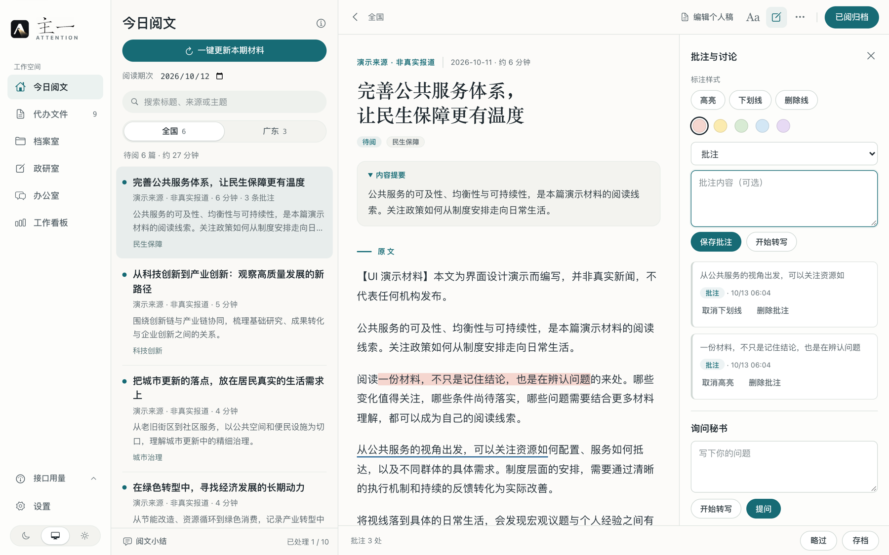
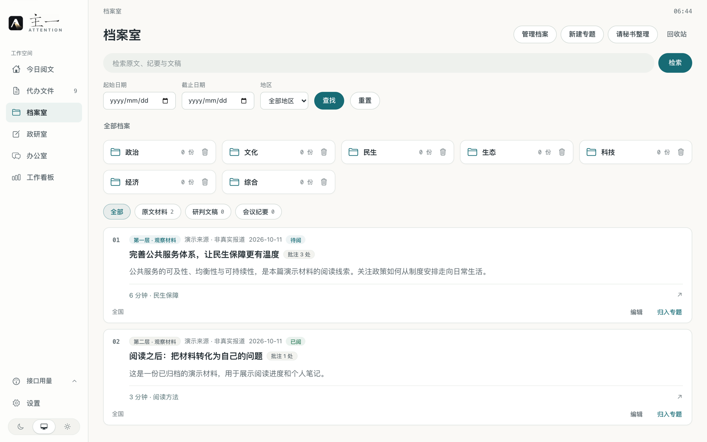
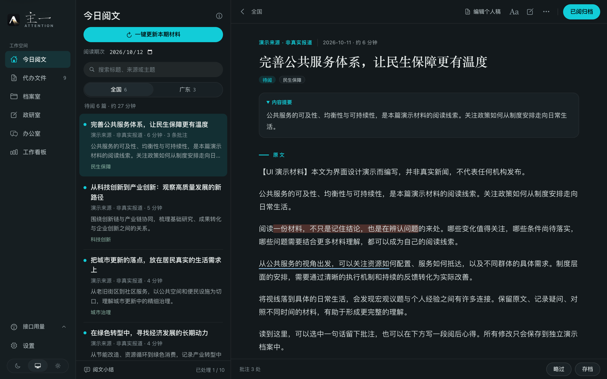
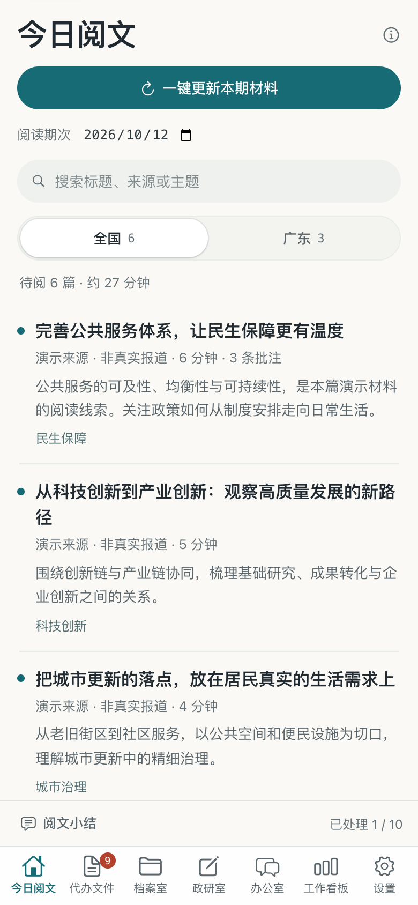
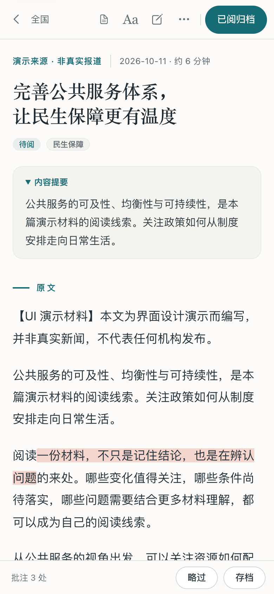
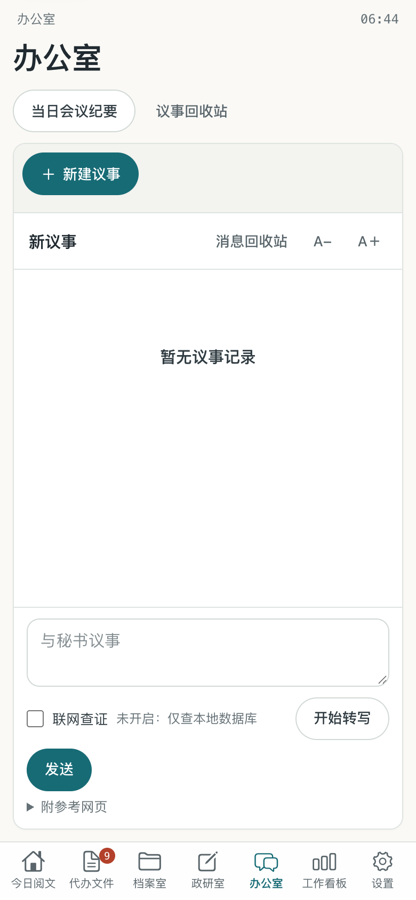

<p align="center">
  
</p>

<h1 align="center">主一 · ATTENTION</h1>

<p align="center"><strong>每天读完一份有尽头的材料，再留下自己的判断。</strong></p>

<p align="center">源码公开 · 运行在自己的电脑上 · 无需账号 · 无需安装依赖</p>

主一是一款面向中文新闻、政策与公共议题的个人阅读工作台。它把每天分散在不同官方网站上的材料收集起来，整理成一份有限的阅读清单，让你在同一个地方完成阅读、标记、批注、讨论与归档。

每个人在自己的电脑上运行一份，数据只存在自己手里。只需要 Python 和一个浏览器。



## 目录

- [为什么做主一](#为什么做主一)
- [三分钟跑起来](#三分钟跑起来)
- [从一份材料开始](#从一份材料开始)
- [功能](#功能)
- [模型接口与费用](#模型接口与费用)
- [数据与隐私](#数据与隐私)
- [当前边界](#当前边界)
- [开发与验证](#开发与验证)
- [附：放到自己的服务器上](#附放到自己的服务器上)
- [许可与反馈](#许可与反馈)

## 为什么做主一

获取信息已经很容易，困难的是收住自己的注意力。

一条接一条的推荐让阅读很难结束。收藏夹越来越长，却很少再被打开。摘要帮我们快速知道结论，也可能让我们跳过原文中的依据、条件与细节。

主一想把这个过程放慢一点，也做完整一点：每天拿到一份读得完的材料，认真看几篇原文，留下几段自己的话，然后结束今天的阅读。

- **阅读应该有尽头。** 材料按期次组织，像一份杂志。全国最多 20 件，每个省份最多 10 件；办理完一篇，不会自动补进另一篇。
- **重要的信息，不必总是合口味。** 选稿依据来源权重、主题与公共重要性规则，不根据你的点击或批注调整。
- **判断要由自己完成。** 原文在阅读流程的中心。原文、个人修订稿和 AI 建议分别保存，依据随时能找回。
- **AI 只做秘书。** 采集、评分、去重和编选由爬虫与规则完成，不需要大模型。AI 只在你主动提问时参与。
- **积累归使用者所有。** 文章副本、标记、批注和文稿保存在本机，可以导出和备份。

## 三分钟跑起来

需要 **Python 3.10 或更新版本**、系统自带的 `curl` 和一个现代浏览器。后端只用 Python 标准库，前端是原生 HTML、CSS 和 JavaScript，**不需要 `pip install`，也不需要 `npm install`**。

```bash
git clone -b refactor/observer-style https://github.com/xyxxxx06221/attention.git
cd attention
```

```bash
# macOS / Linux
python3 launch.py

# Windows
python launch.py
```

浏览器会自动打开 `http://127.0.0.1:8879/`。也可以双击 `启动主一.command`（macOS）或 `启动主一.bat`（Windows）。

- 关闭浏览器不会停止后台。停止时运行 `python3 stop_local.py`，或双击「停止主一」。
- 端口被占用时：`python3 launch.py --port 8880`，停止时带上同样的 `--port`。
- 首次启动是空档案，不附带任何人的数据，也不预装模型密钥。

### 想先看看界面

不想联网采集，可以先启动离线演示。它使用虚构文章和独立的演示目录，不联网、不调用模型、不碰正式档案：

```bash
python3 tools/review_ui.py
```

然后打开 `http://127.0.0.1:8877/`。本页的截图都来自这个演示。

### 桌面安装包

[Releases 页面](https://github.com/xyxxxx06221/attention/releases/tag/v1.0.0-desktop) 提供 Windows 与 macOS 的免安装包，解压后双击即可，不需要 Python。这些安装包构建于界面重做之前，功能相同、界面是上一版；要使用本页所示的新界面，请按上面的方式从源码运行。

## 从一份材料开始

1. **准备阅读范围。** 默认提供全国与广东栏目。在「设置 → 来源与采集」可以增添省份和来源。
2. **更新本期材料。** 在「今日阅文」点「一键更新本期材料」，等待采集和规则编选完成。
3. **打开原文。** 选一篇材料阅读；待阅列表与正文之间的分隔条可以拖动。
4. **留下自己的话。** 选中文字做标记、批注或摘录，或在文末写一段阅后心得。
5. **完成办理。** 略过、存档，或标记为已阅并归档。之后可以从档案室、政研室找回。

不配置模型，以上每一步都能完成。

## 功能

### 今日阅文与代办文件

- 按日期期次和地区查看材料，支持按标题、来源与主题检索。
- 一键更新本期材料，显示采集进度。按事件合并相关报道，保留原始来源与发布日期。
- 「代办文件」汇集所有期次尚未办理的材料，可全文检索。
- 可开启自动准备材料：06:35 预收，07:00 后补齐；电脑休眠时不采集，恢复后补收。

期次按北京时间划分，窗口为前一日 07:00 至当日 07:00。

采集确有缺失时（来源整体失败、单篇抓取失败或日期无法确认），首页会出现提示，可以关闭。来源首页超过扫描上限、或快讯正文过短，只在「来源与采集」的报告中记录。

三种办理操作：

| 操作 | 是否继续待阅 | 是否记为已阅 | 归档 |
| --- | --- | --- | --- |
| 略过 | 否 | 否 | 保留已有归档状态与笔记 |
| 存档 | 是 | 不改变 | 保存到档案室 |
| 已阅归档 | 否 | 是 | 保存到档案室 |

### 专注阅读

三栏分别是导航、待阅列表与原文。正文限制在适合阅读的栏宽内。

- 对原文添加高亮、下划线和删除线，五种标记颜色；再点一次标记即可取消，文字批注保留。
- 记录批注、好词好句、存疑、不同看法与阅后心得。
- 批注面板在阅读器够宽时与正文并排，不遮挡原文。
- 调整字号、进入专注全屏；编辑个人修订稿，原始正文继续保留。
- 就当前材料向秘书提问，查看历史问答。

### 档案室、政研室与办公室

- **档案室**管理原文材料、研判文稿和会议纪要。按关键词、日期、地区、类型与专题查找；新建专题与下级分类；批量归档或移入回收站；导出全部档案。
- **政研室**集中查看所有批注、摘录、疑问与心得，按原文归拢，可返回关联原文。
- **办公室**里与秘书围绕具体问题讨论。按议题保留多段对话；主动开启「联网查证」后才会检索外部资料；可生成当日会议纪要。
- **工作看板**提供每日、每周、每月、每季度的阅读与办理回顾。



### 来源与省份

默认来源：中国政府网、人民网、新华网时政、求是网、广东省人民政府、南方网。

- 全国来源固定保留；省份可以增减，删除省份不会删除已有档案与批注。
- 新增来源需填写名称、HTTPS 栏目或 RSS / Atom 地址、所属地区与权重。
- 先测试，再保存：测试会检查候选链接、正文与发布日期，通过后才能保存。

### 外观与手机尺寸

支持浅色、深色与跟随系统，在侧栏底部或设置页切换，选择只保存在当前浏览器。



窄屏下导航变为底部标签栏，先浏览列表，点开材料进入全屏阅读。

<p align="center">
  
  
  
</p>

以上是响应式页面的预览。应用只监听本机，没有独立的 iOS / Android 安装包，也没有云同步。

## 模型接口与费用

在「设置 → AI 接口」填写任何 Chat Completions 兼容接口：本机模型服务，或自己的远程服务地址、模型名称和密钥。本机回环地址可以不填密钥；远程服务必须使用 HTTPS。

| 功能 | 是否需要模型 |
| --- | --- |
| 采集、来源测试、规则评分、去重、更新本期材料 | 不需要 |
| 原文阅读、标记、批注、心得、检索与手动归档 | 不需要 |
| 编辑个人稿、管理专题、配置省份与来源 | 不需要 |
| 秘书问答、阅后梳理、AI 更新纪要、AI 整理建议 | 需要 |

应用不附送模型额度，也不预装密钥。使用远程接口时，相关原文、问题、批注可能发送到你选择的服务，费用按该服务的规则计算。「联网查证」默认关闭，未开启时秘书只检索本地数据库。细节见 [接口与检索说明](docs/API.md)。

## 数据与隐私

- 文章和个人记录保存在本机 SQLite 数据库中。不需要注册账号，不向项目作者发送遥测或上传档案。
- 程序只监听 `127.0.0.1`，并校验请求的 Host 与来源。它没有多用户认证，**不要把端口直接映射到公网**。
- 模型密钥保存在本机 `settings.json`，不会回传到设置页面，但它不是加密保险库。

| 运行方式 | 默认数据目录 |
| --- | --- |
| 源码运行 | 项目目录下的 `data/` |
| Windows 桌面版 | `%LOCALAPPDATA%\Zhuyi\v1` |
| macOS 桌面版 | `~/Library/Application Support/Zhuyi/v1` |

可用环境变量 `ZHUYI_V1_DATA` 指定其他目录。备份时先停止服务，再复制整个数据目录。备份里可能有密钥和私人笔记；反馈问题或分享截图时不要带上它们。

## 当前边界

- 每个来源最多扫描首页 45 条候选，不代表覆盖网站的全部栏目或全部事件。
- 发布时间只有日期时会保留精度说明，不伪装成准确的时分。
- 网页结构变化、访问限制、图片表格或视频内容可能导致正文提取不完整，请以原站为准。
- 事件合并主要依据标题，可能重复或误合并；规则筛选也可能遗漏值得关注的材料。
- AI 答复需要核对，资料不足时不应被当成已核实的结论。
- 语音转写依赖浏览器支持与麦克风权限，可能使用浏览器厂商的服务。

## 开发与验证

```bash
python3 -m unittest discover -s tests -v
node tests/test_format.js
node tests/test_voice.js
node tests/test_attention.js
node tests/test_chat_ui.js
node tests/test_focus.js
```

Node.js 只用于运行前端测试，日常使用不需要。测试使用临时数据库与模拟的模型响应，不调用任何付费接口。当前为 99 项 Python 测试和 5 组前端检查。

代码结构：

| 位置 | 内容 |
| --- | --- |
| `app.py` | 本机网页服务、采集与编选 |
| `workspace.py`、`archive_ops.py` | 档案、专题、议事与文稿 |
| `source_registry.py`、`source_discovery.py` | 省份与来源的配置、测试与发现 |
| `research.py`、`deepseek_search.py` | 联网查证 |
| `dist/` | 前端，无构建步骤，改完刷新即可 |
| `dist/tokens.css` 等四份样式 | 设计令牌、通用控件、页面外壳、阅读器 |
| `tools/review_ui.py` | 离线界面演示 |

主一提供本机 HTTP API，外部 Agent 可以在你的授权下读取来源、启动规则采集，或把核实后的原文导入档案：[本机 API 文档](docs/API.md) · [信息收集 Agent 使用指南](docs/AGENT.md) · [文章导入模板](examples/article.template.json)。

## 附：放到自己的服务器上

主一是为本机设计的。如果你想让它在一台常开的机器上每天定时采集，可以放到自己的服务器上，再通过 SSH 隧道访问。这是可选做法，仓库不包含任何部署文件；下面是一份可照抄的最小示例。

原则只有一条：**程序继续只监听服务器本机的 `127.0.0.1`，不对公网开放端口。**

**1. 放置代码并建立专用用户**

```bash
sudo useradd --system --home-dir /var/lib/zhuyi --shell /usr/sbin/nologin zhuyi
sudo install -d -o zhuyi -g zhuyi -m 700 /var/lib/zhuyi
sudo git clone -b refactor/observer-style https://github.com/xyxxxx06221/attention.git /opt/zhuyi
```

**2. 服务** `/etc/systemd/system/zhuyi.service`

```ini
[Unit]
Description=Zhuyi reading workbench (loopback only)
After=network-online.target
Wants=network-online.target

[Service]
User=zhuyi
Group=zhuyi
WorkingDirectory=/opt/zhuyi
Environment=ZHUYI_V1_DATA=/var/lib/zhuyi HOME=/var/lib/zhuyi PYTHONUNBUFFERED=1 PYTHONDONTWRITEBYTECODE=1
ExecStart=/usr/bin/python3 /opt/zhuyi/app.py --port 8879 --no-scheduler
Restart=always
RestartSec=5
NoNewPrivileges=true
PrivateTmp=true
ProtectSystem=strict
ProtectHome=true
ReadWritePaths=/var/lib/zhuyi

[Install]
WantedBy=multi-user.target
```

`--no-scheduler` 关闭内置的 06:35 / 07:00 调度，改由下面的定时器决定采集时间。想沿用内置调度，去掉这个参数并在设置里打开「自动准备每日材料」即可。

**3. 每天定时采集** `/etc/systemd/system/zhuyi-collect.service` 与 `zhuyi-collect.timer`

```ini
[Unit]
Description=Zhuyi: collect this morning's edition
After=zhuyi.service
Requires=zhuyi.service

[Service]
Type=oneshot
User=zhuyi
ExecStart=/usr/bin/curl --fail --silent --show-error --max-time 30 --retry 5 --retry-connrefused -X POST -H "Content-Type: application/json" -d "{}" http://127.0.0.1:8879/api/collect
```

```ini
[Unit]
Description=Zhuyi: daily collection at 08:00 Beijing time

[Timer]
OnCalendar=*-*-* 08:00:00 Asia/Shanghai
Persistent=true

[Install]
WantedBy=timers.target
```

```bash
sudo systemctl daemon-reload
sudo systemctl enable --now zhuyi.service zhuyi-collect.timer
```

**4. 从自己的电脑访问**

```bash
ssh -N -L 8879:127.0.0.1:8879 你的用户@你的服务器
```

保持这个连接，然后在本机浏览器打开 `http://127.0.0.1:8879/`。模型密钥在网页的设置页里填写。

**5. 服务器的基本防护**

- SSH 只允许密钥登录，关闭密码登录。
- 防火墙入站只放行 SSH 端口；云厂商的安全组同样只留这一个端口。
- 安装 fail2ban，开启系统的自动安全更新。
- 定期复制 `/var/lib/zhuyi/archive.sqlite3` 作为备份。

不建议用反向代理把它直接挂到公网域名上：应用没有登录功能。确实需要时，必须在代理层加上访问密码和 HTTPS，并把转发请求的 `Host` 改写为 `127.0.0.1:8879`。

## 许可与反馈

主一采用 [PolyForm Noncommercial 1.0.0](LICENSE)：源码公开，个人学习、研究及其他许可允许的非商业用途可以自由使用、修改和部署。超出许可范围的商业使用、收费服务或商业产品集成，需要权利人另行授权。它不是 OSI 定义的开源许可。

项目名称和 Logo 的使用范围见 [NOTICE](NOTICE)。第三方文章及网页的权利属于原权利人，项目许可不授权向公众批量转载第三方全文。

反馈问题时，请说明版本、操作系统、复现步骤与预期结果，可以附上去除私人信息的截图；不要提交密钥、数据目录或私人档案。参与方式见 [CONTRIBUTING.md](CONTRIBUTING.md)，安全问题见 [SECURITY.md](SECURITY.md)。

历史版本的 README 保存在 [docs/history](docs/history/)。
